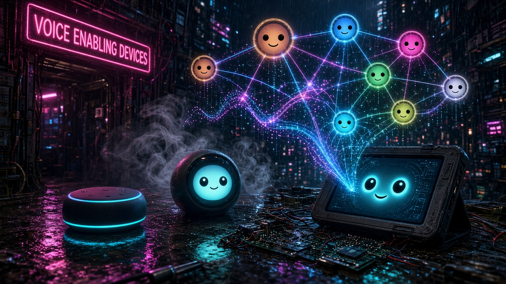

*Hero image generated with Grok Imagine.*

# Voice-enabling devices

**SMF Works**

Old smart speakers and tablets still have a microphone, a speaker, and sometimes a screen. The assistant they shipped with gets slower, narrower, or switched off, and the hardware ends up in a drawer. The plastic is fine. The mic still hears you. This collection is how to give that hardware a second life: keep the device, and point it at an AI agent you already run.

The repository is **voice-enabling-devices**.

## The pattern

A retired device becomes a voice or face front end. The model, the memory, and the real work stay on a computer you control. The device and that computer meet over Wi-Fi.

- You start a turn on purpose: a mute key, a hold-to-talk button, or a tap. The line is not open all day.
- Audio moves between the device and a small bridge on your computer.
- Casual talk can stay on a realtime voice model. A request that needs tools, mail, a calendar, or private facts is handed to an agent, and the spoken answer comes back through the same speaker.

Each device folder is a how-to plus the reference code for that front end. The steps assume the device is **already prepared** and on your network.

## Out of scope

**Rooting, unlocking, bootloader changes, and privileged system installs are out of scope and are not documented here.** This repository does not include exploits or recipes for installing into system or priv-app locations. When a device page says the hardware must already be rooted, that is a prerequisite, not a guide. Only work on devices you own.

Do not commit secrets. API keys, tokens, webhook URLs, ntfy topics, keystores, device serials, MAC addresses, SSIDs, LAN addresses, and personal home paths stay on your machine. Examples in this repo use placeholders such as `<HOST_IP>`, `<TABLET_IP>`, `DOT_HOST`, `<YOUR_WEBHOOK_URL>`, and `<YOUR_WEBHOOK_KEY>`.

## Devices

| Device | Summary | Status |
| --- | --- | --- |
| [Echo Dot (2nd gen)](devices/echo-dot/README.md) | Push-to-talk realtime voice line from the Dot's mute key to an AI agent. | Documented |
| [Fire Tablet (Fire HD 8, 2016)](devices/fire-tablet/README.md) | Hold-to-talk faces, Paula and Liam, posting speech to a host bridge over Wi-Fi. | Documented |
| [Echo Spot (2017)](devices/echo-spot/README.md) | Tap-to-talk round face (SpotEyes) with eight agents and a spoken handoff. | Documented |
| [Echo Show 5](devices/echo-show-5/README.md) | A screen-and-speaker front end in the same pattern. | Coming next week |

## Adding a device

The next page is the Echo Show 5. New devices use the same folder shape and the same section order so a reader can move from one page to the next without learning a new layout. See [CONTRIBUTING.md](CONTRIBUTING.md).

## License

MIT © SMF Works. See [LICENSE](LICENSE). Credit for the original Echo Dot write-up is in [ATTRIBUTION.md](ATTRIBUTION.md).
