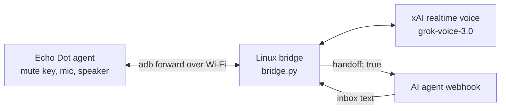

# How I Turned an Old 2nd-Gen Echo Dot into a Realtime Voice Line to My AI Chief of Staff

**Device:** Echo Dot (2nd gen)
**Status:** Documented

Part of the [SMF Works voice-enabling-devices](../../README.md) collection.

Public how-to companion to the X article:

- **Article:** https://x.com/MichaelGannotti/status/2113372170596634942
- **Demo video:** https://x.com/MichaelGannotti/status/2113357366846448033

Rooting and unlocking are out of scope and are not documented on this page.

## What it does

I had an old 2nd-gen Echo Dot sitting in a drawer. Today it is a push-to-talk voice line to Charlie, my Grok Bot chief of staff. I unmute the mic, I hear a beep, and I am talking to Charlie. I mute it and the conversation ends with a low beep.

This page is a **sanitized** snapshot of the post-root software: the on-device agent, the Python bridge, and a systemd unit. It is published by **SMF Works** in **voice-enabling-devices**.

### What you need

- A **2nd-gen Echo Dot that is already rooted**
- An **always-on Linux box** (any distro; the sample unit uses a systemd user service)
- **Home Wi-Fi** for the Dot, plus **adb** (Android Debug Bridge) on the Linux box
- **Python 3** and a virtualenv for the bridge
- A **voice brain** — this build uses xAI realtime voice (`grok-voice-3.0`, male voice Rex)
- An **AI agent webhook** for real work handoff (Charlie, in my case)

## How it works

- **On the Dot:** `dot-agent/DotAgent.java` watches the mute button, streams mic audio (16 kHz mono) out, and plays audio it gets back. It stops listening while it is talking so it does not hear itself.
- **Over adb:** the Linux box connects to the Dot over Wi-Fi and forwards a **local** port to the agent. Nothing needs to listen openly on your LAN. Authorize **only** your Linux box's adb key on the Dot.
- **On the Linux box:** `bridge/bridge.py` keeps the connection alive, relaunches the Dot agent if it dies, and moves audio between the Dot and the voice brain.
- **Handoff:** a status or real-work ask stays quiet. The realtime brain calls `handoff_to_charlie` and does not speak. The fast brain begins with `[HANDOFF]` and nothing else. The bridge POSTs `handoff: true`, waits for `~/charlie-voice/inbox/<session>-<turn>.txt`, and speaks that reply verbatim in the same Rex voice. If the agent does not answer in time, or the webhook fails, it says `I don't have that update yet.`

## Architecture

```
Echo Dot (already rooted)              Always-on Linux box
┌─────────────────────────┐  adb over  ┌────────────────────────────────┐
│ small agent on Dot      │◄───Wi-Fi──►│ Python bridge (systemd user)   │
│ mute key / mic / speaker│            │ brain: xAI realtime voice      │
└─────────────────────────┘            └───────────────┬────────────────┘
                                                       │ handoff (webhook)
                                                       ▼
                                               your AI chief of staff
```



## Setup

These steps start from a Dot that is **already prepared**. This page does not explain how to root, jailbreak, unlock, or patch the device.

- **A 2nd-gen Echo Dot that is already rooted is required.** If you go down that road, do your own research and be responsible about it.
- **Only touch devices you own.** Rooting can brick the device.
- Wireless `adb` should be started by **whatever post-root hook you already have**. This page does not ship boot-hook recipes or name a particular root framework.
- Never commit `config.env`. Copy `config.env.example`, fill in your own values, and `chmod 600` the real file.

### Post-root steps (high level)

1. **Put the Dot on your home Wi-Fi** and give it a **reserved IP** in your router so the address does not wander. Use that address as `DOT_ADB=DOT_HOST:5555` in `config.env` (replace the placeholder).
2. **Set up wireless adb** from your Linux box and authorize only that box's key. Lock adb down so only that box can reach it. Start wireless adb from your existing post-root hook; do not leave adb open to the whole LAN.
3. **Build and push the Dot agent** (`dot-agent/DotAgent.java` → dex). The bridge can push and launch it over adb, so the agent does not need to auto-start on the Dot.
4. **Forward a port with adb** so the bridge talks to the agent through localhost (`LOCAL_PORT` → `BRIDGE_PORT`). On this older Fire OS, reverse forwarding is refused, so forward from the Linux side.
5. **Configure the bridge.** Copy `config.env.example` → `~/charlie-voice/config.env`, fill in webhook + `XAI_VOICE_API_KEY`, keep it mode `600`. Install deps into `.venv`, then enable `systemd/charlie-voice.service` as a user unit (`%h` paths only).
6. **Drive sessions from the real mic state.** Real audio means unmuted → start a session (high beep). Exact zeros mean muted → end it (low beep). Do not count button presses; the hardware mute returns exact zeros.
7. **Connect realtime voice.** Open a WebSocket on unmute (`wss://api.x.ai/v1/realtime`, model `grok-voice-3.0`, voice `rex`) and close it on mute. Stream mic audio up; play 48 kHz PCM back down to the Dot.
8. **Hand off quietly.** The personas no longer tell the model to say a team holding line such as "Let me check with the team on that, one moment" or "Let me pass that to the team, one moment." A status or handoff ask calls `handoff_to_charlie` (realtime) or starts with `[HANDOFF]` (fast brain) and stays silent: no team-holding line, no promised follow-up. The bridge POSTs `handoff: true` to `CHARLIE_WEBHOOK_URL`, waits for `~/charlie-voice/inbox/<session>-<turn>.txt`, and speaks that file verbatim in the same Rex voice. If you mute before the answer arrives, a speak-only session still delivers Charlie's text, or the same timeout line. If Charlie does not answer in time, or the webhook fails, the Dot says `I don't have that update yet.` instead of going silent. If the model improvises a holding line anyway (checking, passing, or waiting on the team, "let you know," "one moment," and similar), the bridge strips it and does not speak it.
9. **Add a cost guard.** Default cap is **15 minutes** per session (`RT_MAX_SECS=900`). At the limit it says goodbye and hangs up.

### Quick start (after you already have a rooted Dot)

The bridge expects to live at `~/charlie-voice/bridge/bridge.py`, with `config.env` beside that directory. Copy **this folder's contents** there (not the whole voice-enabling-devices tree).

```bash
# on your Linux box, from a clone of voice-enabling-devices
mkdir -p ~/charlie-voice
cp -a devices/echo-dot/. ~/charlie-voice/
python3 -m venv ~/charlie-voice/.venv
~/charlie-voice/.venv/bin/pip install -r ~/charlie-voice/requirements.txt
cp ~/charlie-voice/config.env.example ~/charlie-voice/config.env
chmod 600 ~/charlie-voice/config.env
# edit config.env: DOT_ADB, XAI_VOICE_API_KEY, CHARLIE_WEBHOOK_*

mkdir -p ~/.config/systemd/user
cp ~/charlie-voice/systemd/charlie-voice.service ~/.config/systemd/user/
systemctl --user daemon-reload
systemctl --user enable --now charlie-voice
```

`requirements.txt` lists `numpy`, `faster-whisper`, `piper-tts`, `websockets`, and `httpx`. Add any extras you use.

Build the Java agent into a dex with your usual Android build tools, push it to the Dot over adb, and let the bridge launch it. Exact compile commands vary by SDK install; the source of truth for framing is `DotAgent.java`.

## Configuration

Copy `config.env.example` to `~/charlie-voice/config.env` and `chmod 600` it. The names below are the ones the bridge reads. The values in the example are placeholders.

| Name | Placeholder | Role |
| --- | --- | --- |
| `DOT_ADB` | `DOT_HOST:5555` | Wireless adb target. Use the reserved address you assigned. |
| `BRIDGE_PORT` | `8790` | Agent listen port on the Dot (localhost only). |
| `LOCAL_PORT` | `18790` | Matching adb-forward port on the Linux box. |
| `REPLY_BIND` | `127.0.0.1` | Local reply HTTP bind. Keep it on loopback. |
| `CHARLIE_WEBHOOK_URL` | `http://127.0.0.1:PORT/webhook` | Your agent webhook. Replace the whole URL. |
| `CHARLIE_WEBHOOK_KEY` | `changeme` | Bearer token for that webhook. |
| `XAI_VOICE_API_KEY` | `changeme` | Your own key from the xAI console. |
| `RT_MAX_SECS` | `900` | Session cap (15 minutes). |

Optional overrides already commented in the example: `BRAIN`, `RT_URL` (`wss://api.x.ai/v1/realtime`), `RT_MODEL` (`grok-voice-3.0`), `RT_VOICE` (`rex`).

## Screenshots

The 2nd-gen Dot has no display. There is nothing to screenshot. The mute key is the whole interface: unmute to start, mute to end.

## Lessons learned

**No sound at all? Check the level first.** Playback can be effectively silent when gain is too low. Raising the level to about 80% of full scale fixed it. An amplifier mute control was a red herring.

**Clicks came from fighting the Dot's own audio system.** Playing through the normal audio path (and restarting the audio service when needed) fixed it. Clean every clip before sending it:

- remove the DC offset
- resample everything to 48 kHz (mixed sample rates caused glitches)
- add short fade-ins and fade-outs
- pad the clip a little
- send it in one piece, or with a small prebuffer when streaming

**The mute button is a hardware switch.** A muted mic does not go quiet — it returns exact zeros. Following the real mic signal made sessions rock solid.

**Latency is everything in voice.**

| Brain | Result |
| --- | --- |
| Webhook straight to the agent routine | About a 10-second lag. Basically useless for talking. |
| Local Qwen2.5-3B on llama.cpp | Fast, but the answers were poor. |
| Warm Grok CLI + local speech-to-text and text-to-speech | 2 to 4 seconds. "So so." |
| xAI realtime, grok-voice-3.0, male voice Rex | Natural back-and-forth. "Worked perfect." |

**Keep it one voice.** Late handoff answers are spoken in the same realtime Rex voice, including after you mute. Mixing a second TTS voice for sign-offs sounded jarring.

**Stay quiet while Charlie answers.** The holding line made the Dot promise a follow-up it did not have. The realtime and fast personas now tell the model to call `handoff_to_charlie` or begin with `[HANDOFF]` and stay silent. The bridge posts `handoff: true`, waits for the inbox file, and speaks Charlie's text verbatim. An improvised holding line is cut. If the wait times out or the webhook fails, the line is `I don't have that update yet.` Muting early does not drop it: a speak-only session still says Charlie's text, or that same timeout line, in Rex's voice. `tests/test_handoff_quiet.py` checks this offline (`STUB_ECHO=1`).

**Realtime details that mattered:**

- the server does the voice detection
- barge-in works; playback stops when you start talking
- the WebSocket is only open while the mic is unmuted

## Costs

xAI realtime runs about **$0.08 per minute** while a session is open, so a 5-minute conversation is roughly **$0.40**. Because the line only opens on unmute and closes on mute, and each session is capped at 15 minutes, you are not paying for dead air.

## What's next

The realtime experience is the bar. Next step: swap in a **local realtime** brain (speech-to-speech or streaming STT → local LLM → streaming TTS) on a strong home box, by changing one endpoint. The bridge is shaped so that swap is a config change, not a rewrite.

The next device in this collection is the [Echo Show 5](../echo-show-5/README.md), coming next week.

## Safety and privacy

- Do not publish device serials, MACs, SSIDs, LAN IPs, adb private keys, webhook URLs, or API keys.
- Keep adb reachable only from your Linux box.
- Revoke `XAI_VOICE_API_KEY` in the xAI console if you retire the line.

## Layout

```
bridge/bridge.py              # Linux-side bridge (systemd)
dot-agent/DotAgent.java       # On-device agent source
systemd/charlie-voice.service # User unit with %h paths
config.env.example            # Key names + placeholders only
requirements.txt              # Bridge dependencies
tests/                        # Offline helpers (no secrets), including test_handoff_quiet.py
```

Paths above are relative to this folder. At runtime the same tree sits at `~/charlie-voice/` so the user unit's `%h/charlie-voice/` paths resolve. Credit for the original write-up is in [ATTRIBUTION.md](../../ATTRIBUTION.md).

## What this page does not contain

No API keys, webhook URLs, adb private keys, or keystores. No device serials, MAC addresses, SSIDs, LAN addresses, or personal home paths. No rooting, bootloader, exploit, or system/priv-app install steps. `DOT_HOST`, `changeme`, and `http://127.0.0.1:PORT/webhook` are placeholders. Replace them on your own machine.

## License

MIT © SMF Works — see [LICENSE](../../LICENSE).
