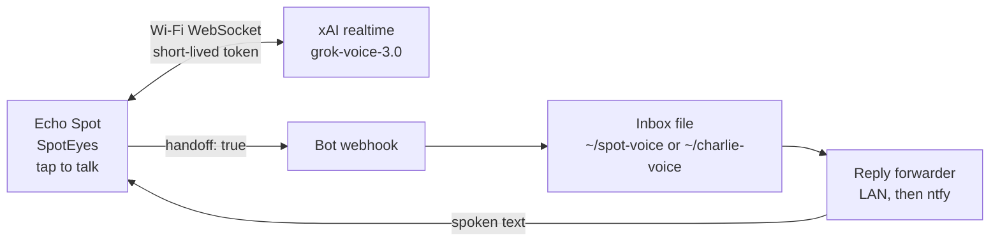

# Echo Spot (2017)

**Device:** Echo Spot (2017)
**Status:** Documented

Part of the [SMF Works voice-enabling-devices](../../README.md) collection.

SpotEyes is a voice face for the round screen. Tap the face, talk, and a Grok realtime session answers in that bot's voice. Ask for real work and the turn is handed to that bot's agent. The spoken reply comes back through the Spot.

The app is `com.smfworks.spoteyes` version 1.3.1 (versionCode 13).

Rooting and unlocking are out of scope and are not documented on this page. The device must already be prepared. Once it is, treat the APK as a normal sideload.

## What it does

1. The screen shows one bot's face: a gradient, two black eye shapes, and the bot's name.
2. Tap the face. A short rising beep plays (700 Hz, then 1100 Hz) and a live realtime voice session starts.
3. Talk. The mic is 16 kHz pcm16. The assistant speaks back as 48 kHz pcm16, with voice detection on the server. The eyes listen and talk along.
4. Tap again to end the session. A short falling beep plays (1100 Hz, then 700 Hz).

Swipe right-to-left for the next bot and left-to-right for the previous one. The eight faces wrap around. The choice is stored in SharedPreferences `spoteyes` / `selected_bot`. Swipes are ignored while a session is open. A clean tap still ends it.

The whole voice path runs over Wi-Fi. A USB cable is only for installing the app or copying hook files, and it can be unplugged afterward as long as the Spot has power.

## How it works

### Realtime voice

The app opens `wss://api.x.ai/v1/realtime?model=grok-voice-3.0` with a short-lived xAI access token in the `Authorization: Bearer` header. TLS uses a pre-connected socket, SNI, and a TLS 1.2 factory so this older Fire OS can reach the API.

Only that short-lived access token is stored on the device, in the app-private file `files/token` (with fallbacks under `spot-eyes/token` on shared storage). Mint the token on a host computer. The refresh token never comes onto the Spot.

### Faces and voices

Colors are the Grok Bot avatar palettes. Eyes and names are black (`#000000`). Grace and Patrick share the one blue. The palette has no second blue.

| Bot | Face gradient | xAI voice |
| --- | --- | --- |
| Charlie | `#AE8968` → `#855C36` brown | orion |
| Grace | `#459FFE` → `#0E74E0` blue | luna |
| Mary | `#FF77BE` → `#E02A88` magenta | iris |
| Wilson | `#1CCF82` → `#009957` green | lux |
| Patrick | `#459FFE` → `#0E74E0` blue | rigel |
| Peyton | `#FFAF38` → `#E08600` yellow | celeste |
| Brett | `#FFFFFF` → `#C2C2C2` lightest neutral | lumen |
| Derek | `#58D3C5` → `#00A592` cyan | altair |

Casual chat stays on the Spot. Charlie is the chief of staff and keeps the Echo Dot handoff path. The others are Grace (video), Mary (marketing), Wilson (writing), Patrick (programming), Peyton (pull requests), Brett (books), and Derek (design).

### Handoff of real work

When you ask for real work (a calendar, email, notes, another bot, or a private or current fact the voice model cannot know), the session calls a handoff tool. The app POSTs the turn to that bot's webhook routine.

- Header: `Authorization: Bearer <YOUR_WEBHOOK_KEY>`
- JSON body: `session_id`, `turn`, `text` (at most 800 characters), `ended`, `brain: "spot"`, `fast_reply`, `handoff: true`, `reply_topic`, `bot`

`host/ROUTINE.txt` is the instruction template to paste into each bot's webhook routine. Substitute `<bot>` with `grace`, `mary`, `wilson`, `patrick`, `peyton`, `brett`, or `derek`. Charlie keeps the existing Echo Dot voice routine and the inbox at `~/charlie-voice/inbox/`.

Each bot has its own webhook URL and key in app-private storage, mode 600:

- Charlie: `files/charlie-url` and `files/charlie-key`
- Others: `files/hooks/<bot>-url` and `files/hooks/<bot>-key`

`host/install-hook.sh` checks a URL and a key (it logs lengths only, never the values) and writes them under `~/spot-voice/<bot>/hooks/`. Copy those two files into the app's private `files/hooks/` directory as `<bot>-url` and `<bot>-key`, mode 0600, readable only by the app. The script does not change Charlie's files.

### Hearing the reply

The bot writes a one-to-three sentence spoken answer to `~/spot-voice/<bot>/inbox/<session_id>-<turn>.txt`. Charlie's replies stay in `~/charlie-voice/inbox/`. It also POSTs the same text to `https://ntfy.sh/<reply_topic>` when a topic is present.

The reply topic is `sha256("<session_id>-<turn>")` as lowercase hex. It is a fresh value per turn. It is not a standing topic name, and it must not be logged.

`host/spot-reply-forward.py` watches those inbox folders, publishes to ntfy, and serves the spoken text on your LAN:

- Charlie: `GET /reply/<session>/<turn>`
- Other bots: `GET /<bot>/reply/<session>/<turn>`
- Health: `GET /health`

The app tries the LAN forwarder first, then falls back to polling ntfy when the LAN port is closed. Write the host address the Spot can reach to the app-private file `files/reply-host`, plain text, no newline. The value is `<HOST_IP>`. The forwarder listens on port 8794 by default. `SPOT_REPLY_BIND`, `SPOT_REPLY_PORT`, and `SPOT_NTFY_URL` override that. A user-level unit is `host/spot-reply-forward.service`.

## Architecture



## Setup

Start from an Echo Spot that is **already prepared**. Rooting, bootloader work, and privileged system-app install steps are out of scope and are not documented here.

The Gradle project is `app/`. It targets minSdk 22 / targetSdk 22 (Fire OS 5), compileSdk 34, Java 17. Point Gradle at your own Android SDK. Do not commit `local.properties` or a keystore.

```bash
cd devices/echo-spot/app
./gradlew :app:assembleDebug
adb install app/build/outputs/apk/debug/app-debug.apk
```

After install, on the device:

- Put the short-lived access token in `files/token`.
- Put each bot's URL and key files where the table in Configuration says.
- Put `<HOST_IP>` in `files/reply-host` if you want LAN replies.

On the host:

```bash
mkdir -p ~/spot-voice
cp devices/echo-spot/host/spot-reply-forward.py ~/spot-voice/
mkdir -p ~/.config/systemd/user
cp devices/echo-spot/host/spot-reply-forward.service ~/.config/systemd/user/
systemctl --user daemon-reload
systemctl --user enable --now spot-reply-forward.service
```

Stage a non-Charlie hook on the host, then copy the two resulting files into the app by whatever private-file copy you already use. The script will not print the URL or the key.

```bash
# URL and key come from your shell or from files you drop.
# SPOT_HOOK_URL and SPOT_HOOK_KEY are read once and not logged.
export SPOT_HOOK_URL='<YOUR_WEBHOOK_URL>'
export SPOT_HOOK_KEY='<YOUR_WEBHOOK_KEY>'
devices/echo-spot/host/install-hook.sh grace
# writes ~/spot-voice/grace/hooks/grace-url and grace-key, mode 600
```

Charlie is not passed through that script. Keep Charlie on the Echo Dot routine and `~/charlie-voice/inbox/`.

## Configuration

| What | Where | Placeholder |
| --- | --- | --- |
| Short-lived xAI access token | app-private `files/token` | mint it on the host; do not commit it |
| Charlie webhook URL | `files/charlie-url` | `<YOUR_WEBHOOK_URL>` |
| Charlie webhook key | `files/charlie-key` | `<YOUR_WEBHOOK_KEY>` |
| Other bots | `files/hooks/<bot>-url` and `files/hooks/<bot>-key` | same placeholders, one pair per bot |
| LAN forwarder address | `files/reply-host` | `<HOST_IP>` |
| Forwarder bind | `SPOT_REPLY_BIND` | `0.0.0.0`, or set this to `<HOST_IP>` |
| Forwarder port | `SPOT_REPLY_PORT` | `8794` |
| ntfy base URL | `SPOT_NTFY_URL` | `https://ntfy.sh/` |

The per-turn topic is computed. Do not invent a fixed topic and do not paste a real one into git. `<reply_topic>` in `host/ROUTINE.txt` is the placeholder the bot routine fills in.

## Screenshots

Eight faces, in swipe order: Charlie, Grace, Mary, Wilson on the top row, Patrick, Peyton, Brett, Derek on the bottom. Tap a face to talk. Swipe to change bots.


## Layout

```
app/                              # Gradle project (com.smfworks.spoteyes)
host/install-hook.sh              # Stage a per-bot URL and key on the host
host/ROUTINE.txt                  # Webhook routine template (<bot> placeholder)
host/spot-reply-forward.py        # Inbox watcher and LAN reply server
host/spot-reply-forward.service   # User unit, %h paths
images/spoteyes-1.3.0-faces.png   # The eight faces
```

## What this page does not contain

No tokens, webhook keys, webhook URLs, ntfy topics, passwords, or refresh tokens. No keystores. No rooting, bootloader, or privileged install steps. No serial numbers, MAC addresses, SSIDs, LAN addresses, or personal home paths. `<YOUR_WEBHOOK_URL>`, `<YOUR_WEBHOOK_KEY>`, `<HOST_IP>`, and `<reply_topic>` are placeholders. Replace them on a private machine.

## License

MIT © SMF Works — see [LICENSE](../../LICENSE).
