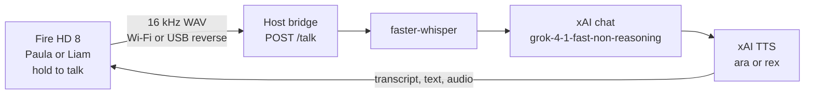
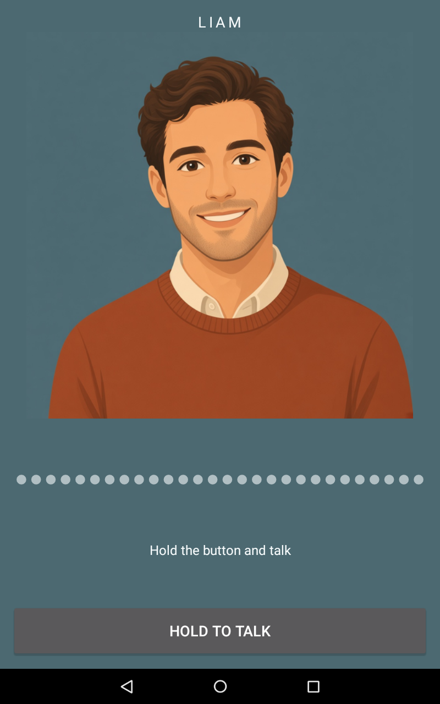

# Fire Tablet (Fire HD 8, 2016)

**Device:** Fire HD 8 (2016)
**Status:** Documented

Part of the [SMF Works voice-enabling-devices](../../README.md) collection.

Hold a button, talk to Paula or Liam, and the tablet speaks the answer. The Fire HD 8 is the face and the microphone. Transcription, the reply, and the voice live on a computer you control, over Wi-Fi.

The app is `com.smfworks.jamesvoice` version 1.4.1 (versionCode 8), labeled **Paula** and **Liam**.

Rooting and unlocking are out of scope and are not documented on this page. The device must already be prepared. Once it is, treat the APK as a normal sideload.

## What it does

The home screen is a two-page swipe.

- Left page: **Paula** (historical slot `who=sarah`), xAI voice **ara**
- Right page: **Liam** (historical slot `who=james`), xAI voice **rex**

Swipe left for Liam and right for Paula. Hold **Hold to talk**. The app records 16 kHz mono PCM and POSTs it as a WAV to the host bridge. A spoken leading "Liam" or "Paula" (or "hey …") overrides the page you are on. The host also treats "pola" and "paola" as Paula. Bars under the portrait move while the reply plays. If the spoken audio is missing, the tablet falls back to on-device Pico TTS.

The same Fire HD 8 can also show an Agents Dashboard, an always-on view of the day's Grok Bot fleet, synced over Wi-Fi. The voice app and the dashboard are separate programs. This folder is the voice interface only. Dashboard source is not included.

## How it works

`host/bridge.py` listens on port 8766. By default it binds `127.0.0.1` only, which is what a USB `adb reverse` tunnel uses. For Wi-Fi, set `TABLET_VOICE_LAN` to the host address the tablet can reach (`<HOST_IP>`) and add the tablet's address to `TABLET_VOICE_ALLOW`. Write that same host address to the app-private file `files/bridge-host`. The app tries `http://127.0.0.1:8766` first (short timeout), then the LAN host.

The tablet calls `POST /talk?who=sarah|james`. `who=paula` and `who=liam` are also accepted. On each turn the bridge:

1. Transcribes the WAV with local faster-whisper (`base.en` by default).
2. Builds a system prompt from a short voice instruction, the local time, and that agent's Hermes persona files: `~/.hermes/profiles/<agent>/SOUL.md`, plus `memories/USER.md` and `memories/MEMORY.md` when those files are present.
3. Calls `https://api.x.ai/v1/chat/completions` with model `grok-4-1-fast-non-reasoning` and the last 12 turns of that agent. Replies are one to three short spoken sentences, with no lists, markdown, links, or emoji.
4. Calls `https://api.x.ai/v1/tts` and returns JSON: the transcript, the short spoken answer, and a base64 audio payload.

The xAI key is read in place from `~/.hermes/.env` (`XAI_API_KEY`) on the host. It is never logged or written by this process, and nothing in this tree puts a key on the tablet. Transcripts are stored under `~/.local/state/tablet-voice/<agent>-transcript.json`.

Voice traffic runs over Wi-Fi, or over USB `adb reverse` while a cable is plugged in. USB is only needed for the install and for that optional loopback tunnel.

## Architecture



## Setup

Start from a Fire HD 8 that is **already prepared** and on your network. Rooting, bootloader work, kiosk or home locking, and privileged install steps are out of scope and are not documented here.

The Gradle project is `app/`. It targets minSdk 22 / targetSdk 22 (Fire OS 5), compileSdk 34, Java 17, `armeabi-v7a`. Point Gradle at your own Android SDK. Do not commit `local.properties` or a keystore.

```bash
cd devices/fire-tablet/app
./gradlew :app:assembleDebug
adb install app/build/outputs/apk/debug/app-debug.apk
```

After install, if you want Wi-Fi, write the host address to the app-private file `files/bridge-host` (plain text, no newline). The value is `<HOST_IP>` and nothing else.

On the host, put this folder's `host/` directory at `~/tablet-voice` (or point the unit at wherever you put it). More detail is in [host/README.md](host/README.md).

```bash
mkdir -p ~/tablet-voice
cp -a devices/fire-tablet/host/. ~/tablet-voice/
python3 -m venv ~/tablet-voice/.venv
~/tablet-voice/.venv/bin/pip install faster-whisper
# plus the standard-library modules bridge.py already uses
mkdir -p ~/.config/systemd/user
cp ~/tablet-voice/tablet-voice.service ~/.config/systemd/user/
systemctl --user daemon-reload
systemctl --user enable --now tablet-voice.service
```

Put `XAI_API_KEY` in `~/.hermes/.env` on the host. The bridge reads that file in place.

`host/tablet-voice-adb.service`, `keep-adb.sh`, and `connect.sh` are optional helpers for USB reverse and adb over Wi-Fi. They require `TABLET_SERIAL` and `TABLET_WIFI=<TABLET_IP>:5555`. They ship with no device serial and no address. Enable `tablet-voice-adb.service` only if you want that helper.

`host/selftest.py` is a short hello-check. Example WAV output for each agent is already in `host/samples/`.

## Configuration

Nothing in git is a credential. Set these on the host, and the one address file on the tablet.

| Name | Placeholder | Role |
| --- | --- | --- |
| `TABLET_VOICE_HOST` | `127.0.0.1` | Bind address. Leave this on loopback. |
| `TABLET_VOICE_PORT` | `8766` | Bridge port. |
| `TABLET_VOICE_LAN` | `<HOST_IP>` | Extra bind address, the same value you write to `files/bridge-host`. |
| `TABLET_VOICE_ALLOW` | `127.0.0.1,::1,<TABLET_IP>` | Client addresses the bridge accepts. Add the tablet. |
| `TABLET_VOICE_KEY_FILE` | `~/.hermes/.env` | Where `XAI_API_KEY` is read from. The key stays in that file. |
| `PAULA_TTS_VOICE` | `ara` | Optional override. |
| `LIAM_TTS_VOICE` | `rex` | Optional override. |
| `TABLET_VOICE_MODEL` | `grok-4-1-fast-non-reasoning` | Chat model. |
| `TABLET_WHISPER_MODEL` | `base.en` | Local transcription model. |
| `TABLET_SERIAL` | set in your shell | adb serial for the optional USB helper. Do not commit it. |
| `TABLET_WIFI` | `<TABLET_IP>:5555` | Optional adb-over-Wi-Fi target. |

`files/bridge-host` on the tablet is a single line, `<HOST_IP>`, with no newline required beyond that and no scheme.

## Screenshots

Paula is the left page. Swipe right to land here. Hold the button and talk.


Liam is the right page. Swipe left to land here.



## Layout

```
app/                 # Gradle project (com.smfworks.jamesvoice)
host/bridge.py       # Transcription, chat, and TTS
host/README.md       # Host environment notes
host/tablet-voice.service
host/keep-adb.sh     # Optional USB / Wi-Fi adb helper
host/connect.sh      # Optional one-shot adb enable
host/selftest.py
host/samples/        # Example hello WAVs
images/              # The screenshots above
```

## What this page does not contain

No API keys, tokens, passwords, or Hermes profile contents. No keystores. No rooting, bootloader, kiosk, home-locking, or privileged install steps. No serial numbers, MAC addresses, SSIDs, LAN addresses, or personal home paths. `<HOST_IP>` and `<TABLET_IP>` are placeholders. Replace them on a private machine.

## License

MIT © SMF Works — see [LICENSE](../../LICENSE).
